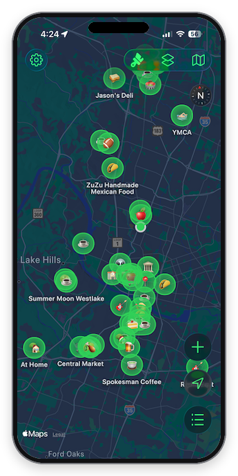
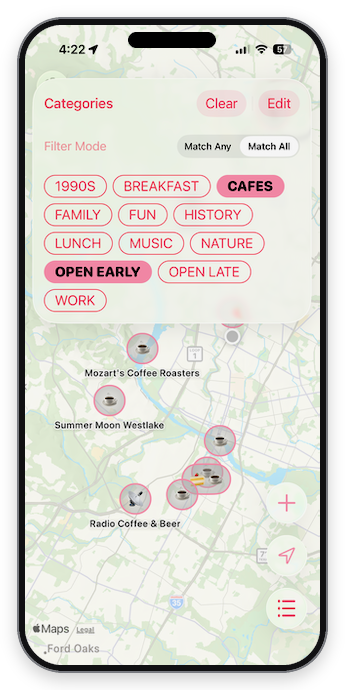
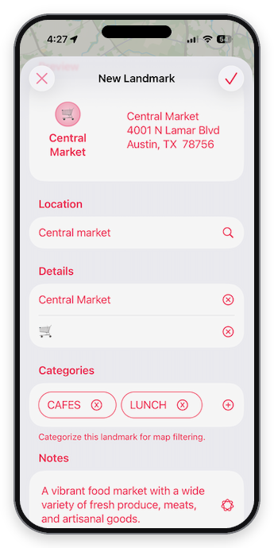
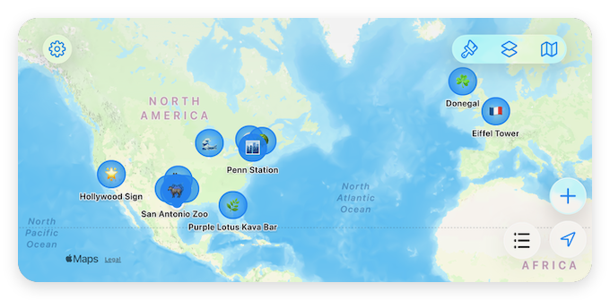
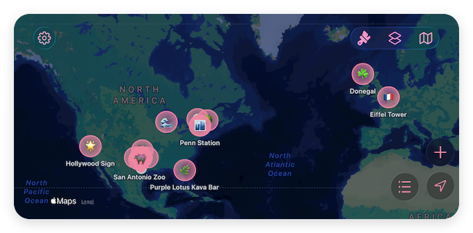

# Map Plus

A lighter, more personal map companion built on Apple's native MapKit, hand-coded on purpose as an architecture sandbox.

  
  
  

**[Watch the walkthrough](https://youtu.be/AARBKyTHfYg)**: basic functionality, themes, dark vs. light mode, and on-device AI.

**Status:** a work in progress, not yet on the App Store. It also serves as the reference implementation for my [daily flight planner](https://github.com/patmcgtx/daily-flight-plan).

## The idea

[Apple Maps](https://maps.apple.com) is a pretty great map app. It's beautiful, and it's useful. And it's doing a lot.

Map Plus is a lighter, more personalized companion with some fun twists: your own places, your own categories, and a look you pick.

## What this project shows

I built it primarily by hand, on purpose, as a learning exercise in making modern iOS apps with SwiftUI and SwiftData. AI tools helped with spikes, refactors, code reviews, documentation and test creation, while I stayed hands-on. It's the deliberate opposite of the AI-first build of Daily Flight Plan.

- **Reactive state:** SwiftData and `@AppStorage` as app-wide, persistent, reactive state, to keep things simple and responsive
- **Testable services:** protocol-based, mockable services, injected live or mock with `@Environment`, so unit tests and SwiftUI previews just work
- **Restraint:** traditional MVVM only when the complexity justifies it
- **Platform depth:** CoreLocation and MapKit, plus on-device Apple Foundation Models where it improves the experience
- **Tests:** unit and UI tests

See [ARCHITECTURE.md](https://github.com/patmcgtx/mapplus/blob/main/MapPlus/ARCHITECTURE.md) for details.

## What it does

### Add your own places to the map

Build your own world with exactly the places you care about. Each place has a name, notes, and an icon that you pick.

### Organize your places into categories

Narrow your map's focus to your favorite coffee shops, restaurants to try, dream vacation destinations, late night haunts, whatever you want. Show any combination of categories, matching any or all of them.

### Polish and personalization

**Themes for the visual pop you want.** Match the map to your vibe:
* Cupertino to look like a standard iOS app
* 8-bit for a retro arcade flair
* Flamingo for a beachy pink vibe
* Kerby for an Austin flair
* Or add your own (with an upgrade)

  
  

**On-device AI assistance.** Apple Foundation Models help provide meaningful defaults for a new place, namely its emoji and (if requested) its descriptive notes. Your favorite coffee shop will likely get a "☕️".

**Movable buttons.** Many of the buttons appear on the lower-right part of the screen by default. Prefer them on the bottom or left side? Drag and drop them wherever you want.

**Fun animations.** When you change your category selection, newly visible places blink into place, and removed places disappear with a poof.

More screenshots

